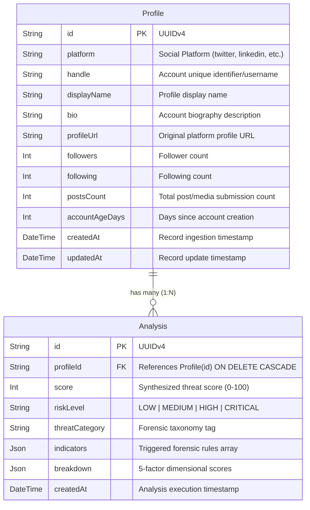

# FPDS — Database & Persistence Architecture (Member 3)

> **Document Version:** 1.0.0  
> **Target Audience:** Digital Forensics Engineers, Backend Developers, and System Administrators  
> **Database Engine:** PostgreSQL 16+  
> **ORM Layer:** Prisma ORM v6 (`@prisma/client`)  

---

## 1. Entity-Relationship (ER) Diagram

---

## 2. Table Specifications

### 2.1. `Profile` Table
Stores ingested social media profile metadata gathered by analysts or external scrapers.

| Column | Type | Constraints | Description |
|--------|------|-------------|-------------|
| `id` | `TEXT` (`UUID`) | `PRIMARY KEY`, Default `gen_random_uuid()` | Unique record identifier |
| `platform` | `TEXT` | `NOT NULL` | Social platform (`twitter`, `instagram`, `facebook`, `linkedin`) |
| `handle` | `TEXT` | `NOT NULL` | Username / handle on the platform |
| `displayName` | `TEXT` | `NOT NULL` | User-facing screen name |
| `bio` | `TEXT` | `NULLABLE` | Bio text or self-description |
| `profileUrl` | `TEXT` | `NULLABLE` | Direct external link to target profile |
| `followers` | `INTEGER` | `NOT NULL`, `>= 0` | Follower count |
| `following` | `INTEGER` | `NOT NULL`, `>= 0` | Following count |
| `postsCount` | `INTEGER` | `NOT NULL`, `>= 0` | Number of posts created |
| `accountAgeDays` | `INTEGER` | `NOT NULL`, `>= 0` | Account age in days |
| `createdAt` | `TIMESTAMP(3)` | `DEFAULT CURRENT_TIMESTAMP` | Ingestion timestamp |
| `updatedAt` | `TIMESTAMP(3)` | Auto-updated on modify | Update timestamp |

### 2.2. `Analysis` Table
Stores historical forensic risk assessments produced by the pure-function risk engine (`riskEngine.js`).

| Column | Type | Constraints | Description |
|--------|------|-------------|-------------|
| `id` | `TEXT` (`UUID`) | `PRIMARY KEY`, Default `gen_random_uuid()` | Unique analysis identifier |
| `profileId` | `TEXT` | `FOREIGN KEY` → `Profile(id)` `ON DELETE CASCADE` | Associated profile |
| `score` | `INTEGER` | `NOT NULL`, Range `0–100` | Synthesized threat score |
| `riskLevel` | `TEXT` | `NOT NULL` (`LOW`, `MEDIUM`, `HIGH`, `CRITICAL`) | Risk tier |
| `threatCategory` | `TEXT` | `NOT NULL` | Classification (e.g., `Bot Syndicate`, `Astroturfing Clones`) |
| `indicators` | `JSONB` | `NOT NULL` | Array of triggered risk rules with points & descriptions |
| `breakdown` | `JSONB` | `NOT NULL` | 5-factor radar scores (Metadata, Burst, Network, Scripting, Avatar) |
| `createdAt` | `TIMESTAMP(3)` | `DEFAULT CURRENT_TIMESTAMP` | Assessment timestamp |

---

## 3. Database Integrity & Cascade Semantics

- **Cascade On Delete (`ON DELETE CASCADE`)**: If a forensic investigation profile is expunged or archived from the database, all historical risk analyses linked to that profile are automatically purged to prevent orphaned assessment records.
- **Relational Query Performance**: The relation between `Profile` and `Analysis` allows `O(1)` joining of the profile's most recent risk score using Prisma's `include: { analyses: { orderBy: { createdAt: 'desc' }, take: 1 } }`.

---

## 4. Common CLI Database Operations

| Task | Command |
|------|---------|
| Create new migration after modifying schema | `npm run prisma:migrate -- --name <name>` |
| Push schema directly without migration files | `npm run prisma:push` |
| Re-generate Prisma Client bindings | `npm run prisma:generate` |
| Verify database connectivity & report status | `npm run db:verify` |
| Populate test forensic profiles & analyses | `npm run db:seed` |
| Complete database reset & fresh re-seed | `npm run db:reset` |
| Launch visual web GUI inspector | `npm run prisma:studio` |
